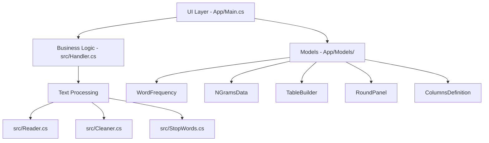

# Document Frequency Counter

A powerful, multi-threaded Windows Forms application for analyzing word frequencies and n-grams across multiple text documents. Built with C# and .NET 10.0, this tool provides comprehensive text analysis with an intuitive, modern UI.

## 📋 Table of Contents

- [Overview](#overview)
- [Features](#features)
- [Architecture](#architecture)
- [Project Structure](#project-structure)
- [Getting Started](#getting-started)
  - [Prerequisites](#prerequisites)
  - [Building](#building)
  - [Running](#running)
- [Usage](#usage)
  - [Loading Documents](#loading-documents)
  - [Analyzing Word Frequencies](#analyzing-word-frequencies)
  - [Exporting Results](#exporting-results)
  - [Analyzing N-Grams](#analyzing-n-grams)
- [Core Components](#core-components)
- [Technical Details](#technical-details)
- [Supported File Formats](#supported-file-formats)
- [Contributing](#contributing)
- [License](#license)

## 🎯 Overview

The Document Frequency Counter is an Information Retrieval (IR) tool that processes multiple text documents to compute word frequencies, calculate term distributions, and identify common patterns. It implements efficient parallel processing for reading, cleaning, and analyzing documents, making it suitable for analyzing large text collections quickly.

## ✨ Features

- **Multi-Document Analysis**: Process multiple files simultaneously with parallel execution
- **Smart Text Cleaning**: Normalizes text to lowercase, handles punctuation, and tokenizes intelligently
- **Stop Word Filtering**: Automatically removes common English stop words for more meaningful analysis
- **Word Frequency Analysis**: Calculate absolute frequencies, relative percentages, and visual distributions
- **N-Gram Extraction**: Generate bigrams (two-word phrases) with frequency analysis
- **Category Classification**: Automatically categorizes words as "Very Common", "Common", or "Moderate" based on frequency
- **Modern UI**: Clean, responsive Windows Forms interface with drag-and-drop support
- **Sortable Tables**: Click column headers to sort by word or frequency
- **Export Capabilities**: Export word frequencies and n-grams to CSV format
- **Cancellable Operations**: Long-running analyses can be cancelled mid-process
- **Visual Feedback**: Progress indicators, percentage bars, and rank badges (top 3 words get crown icons)

## 🏗️ Architecture

The application follows a clean separation of concerns:



### Design Patterns

- **Parallel Processing**: Extensive use of `async/await` and `Task.WhenAll` for concurrent operations
- **Separation of Concerns**: Core logic isolated in `src/` namespace, UI in `App/` namespace
- **Model-View Pattern**: Data models separate from UI logic
- **Factory Pattern**: `TableBuilder` constructs and manages table UI elements dynamically

## 📁 Project Structure

```
Document Frequency Counter/
├── App/                          # UI Layer
│   ├── Main.cs                  # Main form logic and event handlers
│   ├── Main.Designer.cs         # UI component definitions
│   └── Models/                  # UI and data models
│       ├── ColumnsDefinition.cs # Table column configuration
│       ├── NGramsData.cs        # N-gram data model with formatting
│       ├── RoundPanel.cs        # Custom rounded panel control
│       ├── TableBuilder.cs      # Dynamic table construction
│       └── WordFrequency.cs     # Word frequency data model with formatting
├── src/                         # Core Business Logic
│   ├── Cleaner.cs              # Text tokenization and cleaning
│   ├── Handler.cs              # Frequency counting and n-gram generation
│   ├── Reader.cs               # File reading operations
│   └── StopWords.cs            # Stop word filtering
├── test/                       # Sample test documents
│   ├── grand_finally.txt       # Larger sample text
│   ├── text2.txt               # Memory/reconstruction sample
│   └── text3.txt               # Information age sample
├── Program.cs                  # Application entry point
├── Document Frequency Counter.csproj
├── Document Frequency Counter.sln
└── build.sh                    # Build and run script
```

## 🚀 Getting Started

### Prerequisites

- [.NET 10.0 SDK](https://dotnet.microsoft.com/download) or later
- Windows OS (Windows Forms application)
- Visual Studio 2022, JetBrains Rider, or any compatible IDE (optional)

### Building

Using the command line:

```bash
cd "Document Frequency Counter"
dotnet build
```

Or use the provided build script:

```bash
./build.sh
```

### Running

```bash
dotnet run
```

Or build and run with the script:

```bash
./build.sh  # This runs clear, dotnet build, and dotnet run
```

## 💡 Usage

### Loading Documents

1. Launch the application
2. Either **drag and drop** text files onto the drop zone, or **click** the drop zone to browse
3. Supported formats: `.txt`, `.csv`, `.log`, `.xml`, `.json`
4. The file count indicator will show how many files are loaded

### Analyzing Word Frequencies

1. Load one or more documents
2. Click the **"Analysis"** button to begin processing
3. Results appear in the sortable table showing:
   - **Rank**: Position based on frequency (top 3 get crown icons 👑)
   - **Word**: The token after cleaning and stop-word removal
   - **Frequency**: Absolute count across all documents
   - **Percentage**: Relative frequency as percentage of total words
   - **Distribution**: Visual bar chart (█ blocks)
   - **Category**: Classification based on frequency threshold

### Exporting Results

- **Export Word Frequencies**: Click "Export" to save all results (up to all analyzed words) as `export.csv`
- **Export N-Grams**: Click "NGrams" to generate and export bigrams as `nGrams.csv`

### Analyzing N-Grams

N-grams are automatically processed during export. The system extracts consecutive pairs of words (bigrams) after stop-word removal, counts their frequencies across all documents, and exports them with rankings, frequencies, percentages, and visual distributions.

## 🔧 Core Components

### `src/Reader.cs`
Handles asynchronous file reading using `StreamReader`. Reads multiple files in parallel and returns their content as strings. Gracefully handles I/O exceptions.

### `src/Cleaner.cs`
Performs text normalization:
- Converts to lowercase using `ToLowerInvariant()` for language-agnostic processing
- Tokenizes using regex: `[^\w'-]+` to split on non-word characters
- Preserves apostrophes (`'`), hyphens (`-`), and underscores (`_`) within tokens
- Filters out empty tokens

### `src/StopWords.cs`
Contains a curated list of English stop words (articles, prepositions, pronouns, auxiliaries, etc.). Provides efficient lookup using `HashSet<string>` and parallel removal across token arrays.

### `src/Handler.cs`
The analysis engine:
- **`GetFrequenciesAsync()`**: Merges word frequencies across all documents, sorts by descending frequency
- **`GetNGramsAsync()`**: Generates bigrams (consecutive word pairs), merges across documents, sorts by frequency
- Uses parallel processing throughout for optimal performance
- Skips empty/null tokens and special characters

### UI Components

- **`Main.cs`**: Orchestrates the workflow, handles drag-and-drop, manages async operations with cancellation support
- **`RoundPanel.cs`**: Custom panel with rounded corners, anti-aliasing, and double-buffering for smooth rendering
- **`TableBuilder.cs`**: Dynamically constructs sortable tables with alternating row colors and interactive elements
- **`WordFrequency` / `NGramsData`**: Rich models with formatting methods for display and export

## ⚙️ Technical Details

- **Framework**: .NET 10.0 Windows Forms
- **Language**: C# with nullable reference types enabled
- **Concurrency**: `async/await`, `Task.WhenAll`, `Task.Run` for CPU-bound operations
- **UI**: Custom painted controls with `GraphicsPath` for rounded corners
- **Performance**: Double-buffering enabled to reduce flicker, parallel processing throughout
- **Thread Safety**: Cancellation tokens for long-running operations
- **Memory**: Efficient with LINQ and streaming operations

### Category Thresholds

| Category | Frequency Range | Color |
|----------|----------------|-------|
| 🔥 Very Common | > 500 | Red (`#DC2626`) |
| 📈 Common | 301 - 500 | Orange (`#F59E0B`) |
| 📊 Moderate | 1 - 300 | Blue (`#3B82F6`) |

### Processing Pipeline

1. **Read** → Load all selected files in parallel
2. **Clean** → Tokenize and normalize each document in parallel
3. **Filter** → Remove stop words from all documents in parallel
4. **Count** → Calculate word frequencies per document in parallel
5. **Merge** → Combine all documents into global frequency map
6. **Sort** → Order by frequency descending
7. **Display/Export** → Present results in UI or CSV

## 📄 Supported File Formats

- `.txt` - Plain text files
- `.csv` - Comma-separated values
- `.log` - Log files
- `.xml` - XML documents
- `.json` - JSON files

*Note: All files are read as plain text regardless of format.*

## 🧪 Sample Data

The project includes sample test files in the `test/` directory:
- `grand_finally.txt` - Technology and computing related content
- `text2.txt` - Psychology/memory related content
- `text3.txt` - History and information age content

## 🤝 Contributing

This is an academic project for an Information Retrieval course. While not actively maintained for external contributions, the codebase serves as a good example of:
- Parallel processing in C#
- Windows Forms UI customization
- Text processing and IR techniques
- Clean architecture principles

## 📝 License

This project is created for educational purposes as part of an Information Retrieval course.
